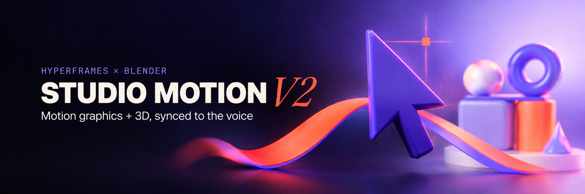
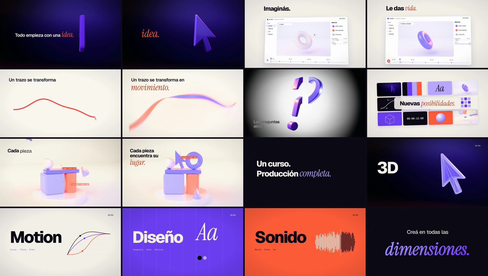
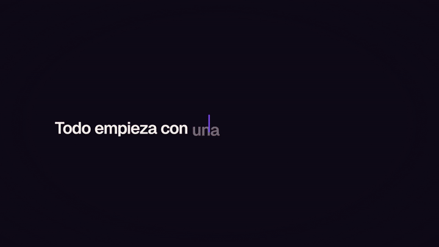
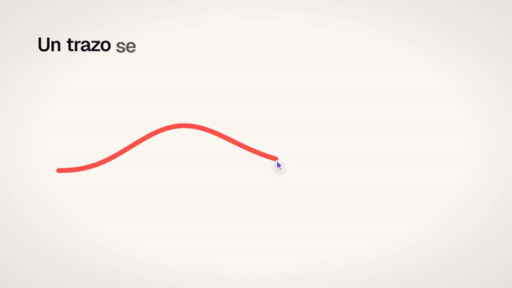

<div align="center">



**Swap the voice-over and the whole ad re-times itself: every word, cut and 2D↔3D match lands on the voice.**

[](https://github.com/Mats2208/studio-motion-v2/releases)
[](https://hyperframes.heygen.com)
[](https://www.blender.org)
[](https://github.com/Mats2208/agent-skills/tree/main/skills/motion-3d-hibrido)
[](LICENSE)

<br/>

<table>
<tr>
<td align="center"><strong>25.000 s</strong><br/><sub>750 frames · 1080p30</sub></td>
<td align="center"><strong>8</strong><br/><sub>Blender shots from scratch</sub></td>
<td align="center"><strong>35</strong><br/><sub>words synced to picture</sub></td>
<td align="center"><strong>4</strong><br/><sub>voices, 0 3D re-renders</sub></td>
<td align="center"><strong>−14.1</strong><br/><sub>LUFS · −1.5 dBTP</sub></td>
</tr>
</table>

**▶ [Watch the ad (MP4, 18 MB)](https://github.com/Mats2208/studio-motion-v2/releases/latest)**

</div>

---

## Showcase

<p align="center"></p>
<p align="center"><sub>The 8 acts in order. <strong>Dark and light sets alternate act by act</strong>, and the violet cursor (2D or 3D) is on screen in every act except the four-card montage. Each italic coral word is the one the voice stresses.</sub></p>

<table>
<tr>
<td width="50%">
<p align="center"></p>
<p align="center"><sub><strong>HTML caret → Blender cursor.</strong> The caret grows to the bar's measured box (86×526 px at 1303, 502), taken from the render's first frame, then crossfades into the cursor, which is held edge-on for 0.12 s.</sub></p>
</td>
<td width="50%">
<p align="center"></p>
<p align="center"><sub><strong>SVG stroke → 3D ribbon.</strong> Blender unprojects the same 64 points from its top-down camera: <strong>3.4 px</strong> max error. The stroke's color (#FA504A) was sampled from the render, not picked.</sub></p>
</td>
</tr>
</table>

## What it does

| | Layer | Details |
|---|---|---|
| **3D** | Blender 5.1 Cycles · OptiX | 8 shots, one script each, built from an empty scene: cursor, torus, ribbon, split question mark, snapping sculpture, wire→shaded cursor, extruded type, logo. Keyframe per frame from analytic easing |
| **Motion** | HyperFrames + GSAP 3.15 | Word-synced kinetic type, a design-app UI with real clicks on the beat, snap guides with coordinates projected from Blender, a 12-tile grid, a 4-card montage, grain, light leak |
| **Voice** | ElevenLabs + faster-whisper | Final voice: Malena (Argentine Spanish). Phrases are placed by **acoustic anchors**, so a new voice lands on the same 3D moments |
| **Mix** | numpy · pyloudnorm | Voice-keyed ducking, effects aligned by their transient peak, 1.1 s cosine fade, limiter as the last stage → −14 LUFS |
| **Proof** | `tools/verify.py` | Format, loudness, freezes, pure-black frames and **per-word sync measured by the word's own color** |

## How it works

```
voice.mp3 ──whisper + ElevenLabs alignment──► timeline.json ◄── the only clock
                                                  │
        ┌─────────────────────────────────────────┼──────────────────────────────┐
        ▼                                         ▼                              ▼
 blender/shots/bN_*.py                    tools/mix_audio.py              film/index.html
 bake motion per frame                    voice + score + effects         reads timeline.js:
 render in background ─► encode_shots ─► film/assets/renders  ──────►    words, beats, events
                                          mix.wav ──onsets.py──► word onsets ─┘
                                                  │
                     hyperframes render ─► mux the measured master ─► verify.py
```

Every time on screen comes from `timeline.json`. Blender reads it to bake its animation and the composition loads it as `timeline.js`. Nothing is nudged by eye: if a word is late, its number is corrected at the source.

## Every number here was measured

| Claim | How it was checked |
|---|---|
| Words appear on the syllable | Each stressed word's own color shows up **0–2 frames** after its acoustic onset (5 ms hop, 15 ms RMS, +12 dB rise) |
| Voice lands on the 3D | After placement the onset is re-measured on the placed track and each phrase is corrected: **≤ 4 ms** anchor error after one pass |
| 2D↔3D matches | Ribbon centre line projected back to pixels vs the SVG stroke: **3.4 px** max |
| Loudness | `ffmpeg ebur128=peak=true` on the delivered MP4: **−14.1 LUFS, −1.5 dBTP** |
| No dead frames | `freezedetect n=0.001:d=1` → none; `blackdetect pix_th=0.03` → none (the ink set is 4.7 % luma, so the default 10 % threshold would misread it as black) |
| Brand color | AgX visibly desaturated #6A3DF0 in test renders, so every shot uses Khronos PBR Neutral |

The 31 mistakes that got here, each with symptom, cause and fix, are in the skill's [lessons file](https://github.com/Mats2208/agent-skills/blob/main/skills/motion-3d-hibrido/references/lecciones.md).

## Quick start

Render the finished ad without Blender. The encoded 3D shots, the mix and the timeline are in the repo.

```bash
git clone https://github.com/Mats2208/studio-motion-v2.git
cd studio-motion-v2/film
npx hyperframes@0.8.164 render --quality delivery --output renders/studio-motion-v2.mp4
```

<sub>Needs Node 22+ and ffmpeg on PATH. About 40 s on a desktop GPU. HyperFrames re-levels some mixes, so for the exact master run `python tools/build_voice.py` (below), which muxes `mix.wav` back in.</sub>

## Swap the voice

```bash
pip install -r requirements.txt
export ELEVENLABS_API_KEY=...                      # read at call time, never written to disk
python tools/eleven.py voices "argentina"          # shared library: female, Spanish
python tools/eleven.py tts <voice_id> audition/new.mp3 "<script>" 0.35 0.5 1.0
python tools/build_voice.py new audition/new.mp3 audition/new.json
```

`build_voice.py` places each phrase so its anchor word hits the moment Blender rendered: idea 1.466, vida 6.482, movimiento 8.919, abren 11.304, lugar 15.023, dimensiones 22.107 s. Then it mixes, renders, muxes the master and verifies. If two phrases would overlap, it fails **before** mixing.

## Make your own

This repo is the worked example of the **[motion-3d-hibrido](https://github.com/Mats2208/agent-skills/tree/main/skills/motion-3d-hibrido)** skill. To build a new ad, install the skill and ask your agent for one: it starts from the templates (`plantillas/`) and from this method.

To fork this repo instead, change these:

- [ ] `voice.json` and the script in `tools/eleven.py tts ...`: your copy and your voice
- [ ] `ANCHORS` in `tools/build_timeline.py`: which word lands on which 3D moment
- [ ] `blender/shots/`: your objects. Keep the `build(preview)` contract and read times from `lib_sm.TL`
- [ ] `palette` in `tools/build_timeline.py` and the CSS variables in `film/index.html`
- [ ] `film/index.html` acts: copy, UI and cards

Don't touch: the per-frame baking (no `onUpdate`; the renderer re-fires callbacks on seek), the limiter as the last mix stage, and the master mux in `build_voice.py`.

Full rebuild including 3D: open Blender 5.1, run each `bN_*.build()` (or let your agent do it live over the Blender MCP), then `python tools/render_queue.py add <scene>` + `work`. That's 1.7 GB of frames and about 35 min on an RTX 3060.

## Repo layout

```
blender/      lib_sm.py (shared helpers), shots/b1…b8, studio-motion-v2.blend, render_shot.py
film/         HyperFrames project: index.html, timeline.js, assets/{renders,audio,fonts}
tools/        build_timeline · mix_audio · onsets · build_voice · encode_shots · render_queue · verify · eleven
analysis/     word timings, per-voice timelines and verification reports
audition/     the three auditioned voices (Valeria, Lucía, Malena) with their alignments
prompts/      the 3,000-word build prompt this ad was made from
demo/         README media; banner.prompt.txt regenerates the banner
```

## What it doesn't do

- **Tested only on Windows 11** with an RTX 3060 and Blender 5.1.2. Paths in `render_queue.py` assume the default Blender install.
- **The PNG frame sequences are not in git** (1.7 GB). The encoded shots are, which is enough to re-render the ad.
- **The music and four of the effects come from an earlier ElevenLabs production** and are reused as-is. The V2 effects (no bells) are in `film/assets/audio/sfx2`.
- **The anchors are tied to these renders.** If your voice can't fit a phrase between two anchors at speed 1.0, regenerate it faster or move the anchor and re-render that shot.

## License

[MIT](LICENSE). The fonts (Geist, Geist Mono, Instrument Serif) are under the SIL Open Font License; see `film/assets/fonts/`.
